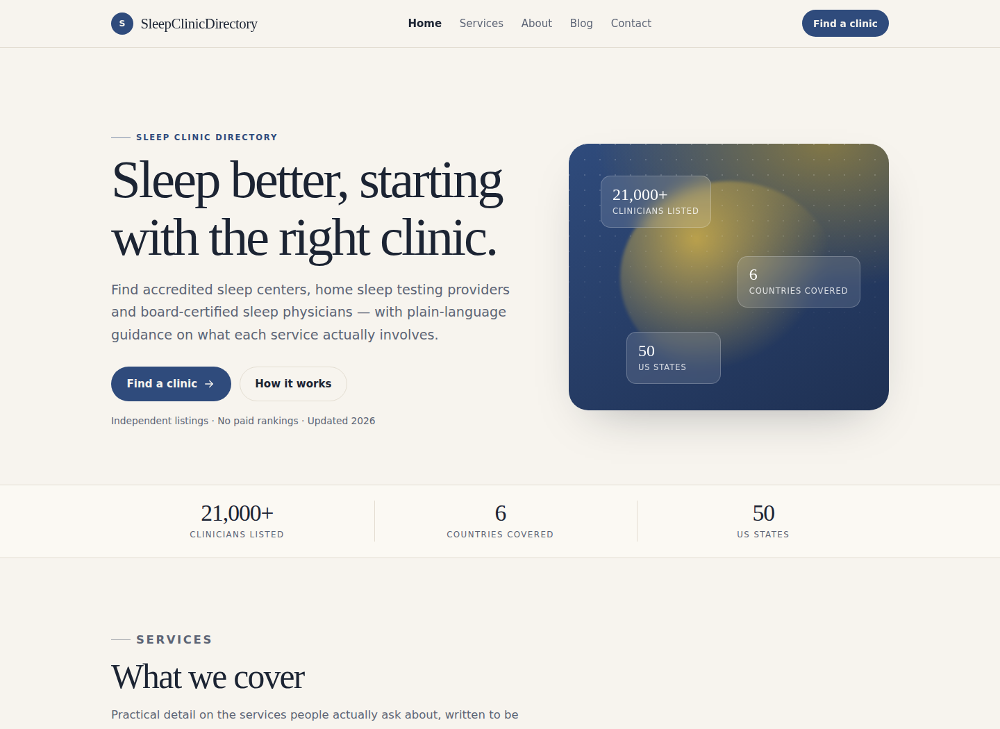

# Site Kits

**ClinicKit, TradeKit and CharterKit** — one Astro theme core with twelve vertical presets. Each preset builds a complete, self-contained site: homepage, services, about, contact, blog index, article pages, 404, `robots.txt` and `sitemap.xml`.

Built for local-service and directory projects that need a credible site in an afternoon rather than a blank starter.

[](https://github.com/ahmetalkan/site-kits/actions/workflows/deploy.yml)

**[Live demos →](https://ahmetalkan.github.io/site-kits/)**



## The three cores

| Core | Vertical | Presets |
| --- | --- | --- |
| **ClinicKit** | Healthcare, dental, medical directories | `sleep`, `doctors`, `au`, `de`, `guide`, `peds`, `dental`, `eye` |
| **TradeKit** | Home services and installed products | `sauna`, `garage`, `golf` |
| **CharterKit** | Travel and charter | `charter` |

The cores share one layout system and differ in palette, corner treatment, type scale and default copy. A preset is a data object — not a fork — so a fix in the layout reaches every site.

## Quick start

```bash
npm install
SITE_PRESET=sleep npm run dev
```

Build one preset:

```bash
SITE_PRESET=sleep OUT_DIR=dist/sleep npm run build
```

Build all twelve for deployment under a base path:

```bash
npm run build:all
npm run showcase
```

That writes `dist/<preset>/` for every preset with `BASE_PATH=/site-kits/<preset>`, then generates `dist/index.html`, the collection page used by the live demos. `npm run build:all -- sleep de` builds a subset.

Override the base path when hosting somewhere else:

```bash
BASE_PATH=/themes/sleep npm run build:all -- sleep
```

`npm run build` without `BASE_PATH` builds for the domain root, which is what `npm run dev` and `npm run preview` expect.

## What a preset defines

`src/config/presets.ts` is the only file you edit to make a new site:

```ts
{
  slug: 'sleep',
  site: 'https://sleepclinicdirectory.com/',
  demoUrl: 'https://site-kits-sleep.pages.dev/',
  brand: 'SleepClinicDirectory',
  themeName: 'ClinicKit',
  vertical: 'clinic',
  schemaType: 'MedicalClinic',
  locale: 'en',
  palette: { /* eight colours */ },
  seo: { title, description },
  hero: { eyebrow, title, body, primaryCta, primaryHref, secondaryCta, secondaryHref },
  stats: [...],
  services: [...],
  about: { title, body, bullets },
  faqs: [...],
  contact: { title, body, email, phone, address, hours },
  footer: { phrase, label, href },
  posts: [...]
}
```

Everything is rendered from that object: navigation, footer columns, JSON-LD type, sitemap entries and the canonical URL.

## Pages

| Route | Contents |
| --- | --- |
| `/` | Hero, stats, services, about, recent posts, FAQ (with `FAQPage` JSON-LD), CTA |
| `/services/` | All services, two FAQs, CTA |
| `/about/` | Positioning, checklist, listing policy |
| `/contact/` | Contact details and a form |
| `/blog/` | Post index, newest first |
| `/blog/<slug>/` | Article with `BlogPosting` JSON-LD |
| `/404.html` | Not found, `noindex` |
| `/robots.txt`, `/sitemap.xml` | Generated from the preset |

## Design notes

- **No client-side JavaScript.** The mobile menu is a native `<details>` element; the FAQ uses `<details>` too. Pages ship as HTML and CSS only.
- **One stylesheet**, roughly 1,000 lines, driven by eight CSS custom properties per preset.
- **Accessible defaults**: skip link, visible focus rings, semantic landmarks, `aria-current` on the active nav item, reduced-motion support.
- **No external fonts or images.** The display face is a system serif stack, the hero visual is generated with CSS gradients, so there is nothing to block first paint.
- **Structured data** is generated per page: `Organization`/`MedicalClinic`/`Dentist`/`TravelAgency` on every page, `FAQPage` on the homepage, `BlogPosting` on articles.

## Footer credit

Each preset renders one credit line in the footer:

```html
Powered by <a href="https://example.com/" rel="noopener">Brand</a> · ClinicKit
```

The phrase (`Powered by`, `Built by`, `A theme by`, `Website by`, `Made by`, `Eine Theme von`) and the target are preset fields.

For self-hosted builds the credit is on by default and can be removed — edit `footer` in the preset, or delete the `.credit` block in `src/components/Footer.astro`. If you publish a modified copy, keep the MIT license notice.

## Adding a preset

1. Copy an existing object in `presets.ts`.
2. Change `slug`, `site`, `demoUrl`, `brand`, `palette` and the copy.
3. Pick a `schemaType` that matches the business.
4. Run `npm run build:all -- <slug>`.

No component changes are required.

## Scripts

| Command | Purpose |
| --- | --- |
| `npm run dev` | Dev server for `SITE_PRESET` (defaults to `sleep`) |
| `npm run build` | Build the active preset to `dist/` |
| `npm run build:all` | Build all presets to `dist/<slug>/` under `/site-kits/<slug>` |
| `npm run showcase` | Generate `dist/index.html`, the demo collection page |
| `npm run preview` | Preview the last build |
| `npm run check` | Astro + TypeScript diagnostics |

## Requirements

Node 20+ and npm. Built and verified with Node 24 and Astro 7.

## License

MIT — see [LICENSE](LICENSE).
